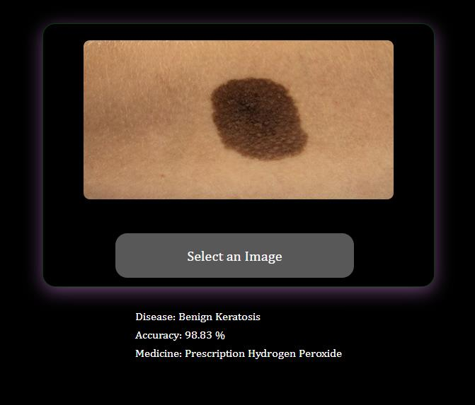
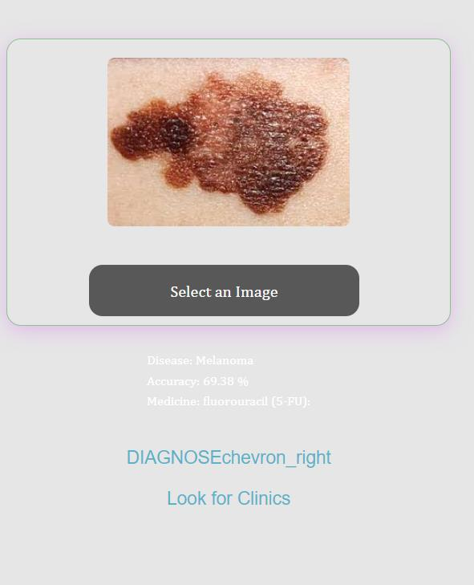
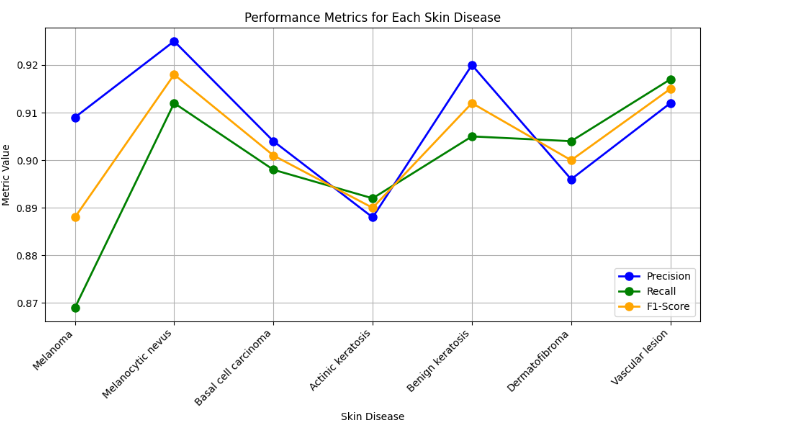

# AI Skin Disease Detection & Prescription Assistant

**A web app that uses deep learning to classify skin lesions from a photo and suggest a matching treatment.**

Upload a photo of a skin lesion and the app predicts which condition it most likely is (for example melanoma, benign keratosis or dermatofibroma), shows how confident the model is, and recommends a commonly prescribed treatment for that condition.

> Final-year B.Tech project in Computer Science & Engineering, Hindustan Institute of Technology and Science, Chennai (2024). Team of two.

  
  

---

## What it does

- **Detects skin conditions from a photo** using a convolutional neural network (CNN) trained on 7 lesion types: melanoma, melanocytic nevus, basal cell carcinoma, actinic keratosis, benign keratosis, dermatofibroma and vascular lesions.
- **Shows the result with a confidence score**, so users can see how sure the model is.
- **Suggests a treatment** for the detected condition, from a prescription database.
- **Points users to clinics**, because the tool supports diagnosis but does not replace a dermatologist.
- **User accounts:** sign up, log in and secure sessions.

## How it works

1. **Upload:** the user uploads a photo through the web interface; the server checks and stores it.
2. **Preprocess:** the image is resized and normalised to match the model's input.
3. **Classify:** the CNN extracts visual features (convolution, ReLU and pooling layers) and outputs a probability for each condition.
4. **Recommend:** the top prediction is matched to a treatment recommendation and shown to the user.

## Tech stack

| Area | Tools |
|---|---|
| Machine learning | Python, TensorFlow, Keras (CNN), NumPy |
| Training | Anaconda, NVIDIA GTX 1650 GPU, Adam and RMSProp optimisers |
| Web app | Flask (routing, file upload, authentication), HTML, CSS |
| Data | Dermoscopic skin lesion images across 7 classes |

## Training & results

- Data split: 85% training, 15% validation, plus a separate set of 106 test images.
- Trained for 100 epochs with 10-fold cross-validation.
- **Overall accuracy of about 70% on the test images**, with per-class precision, recall and F1 scores between roughly 0.87 and 0.92 in evaluation.

**Limitations:** results depend heavily on image quality and on how well each condition is represented in the training data. Some predictions come with low confidence. This was a research project and is **not a medical device**; it should never replace a doctor's diagnosis.

## My role

- Built the **Flask web application**: the interface for uploading images, displaying predictions, confidence and treatment suggestions.
- Took part in **dataset collection and model training**, and produced the prediction results.
- Ran **testing and performance evaluation**, and wrote the documentation and research references.

Teammate: Binyam Zenebe (dataset preparation, feature selection, project management, model training). Supervised by Ms. R. Radhika, Assistant Professor, CSE.

## What I'd improve next

- Train on a larger, more diverse dataset (more skin tones and photo conditions) to raise accuracy.
- Try transfer learning with modern pre-trained models (for example EfficientNet).
- Add skin-type classification, and a mobile version for taking photos directly.

---

**Yonas Habte** · yonashabte023@gmail.com
